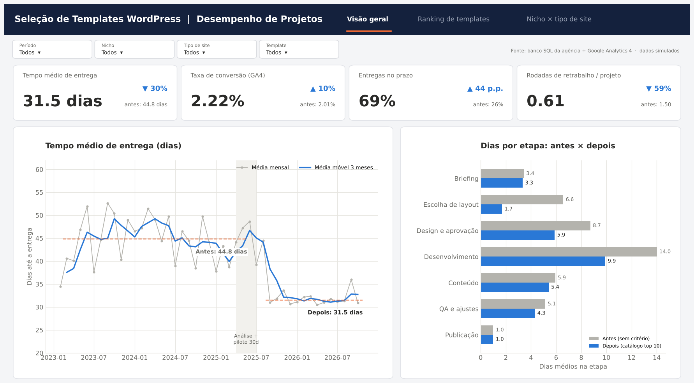
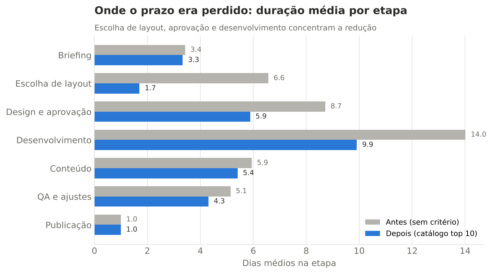
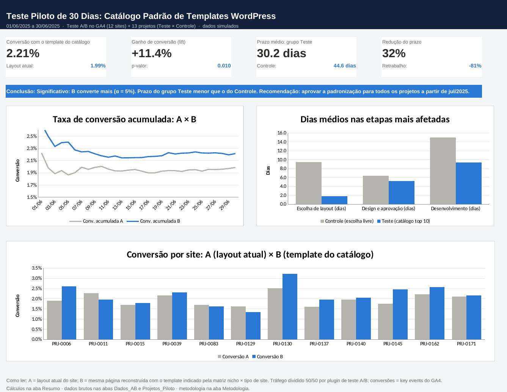
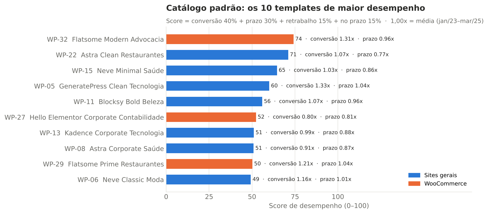
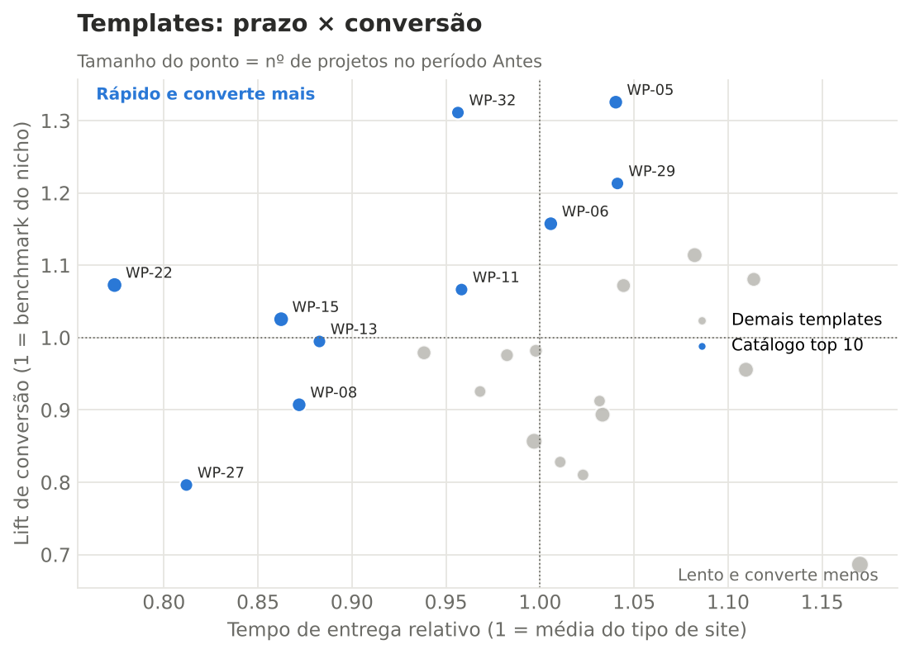
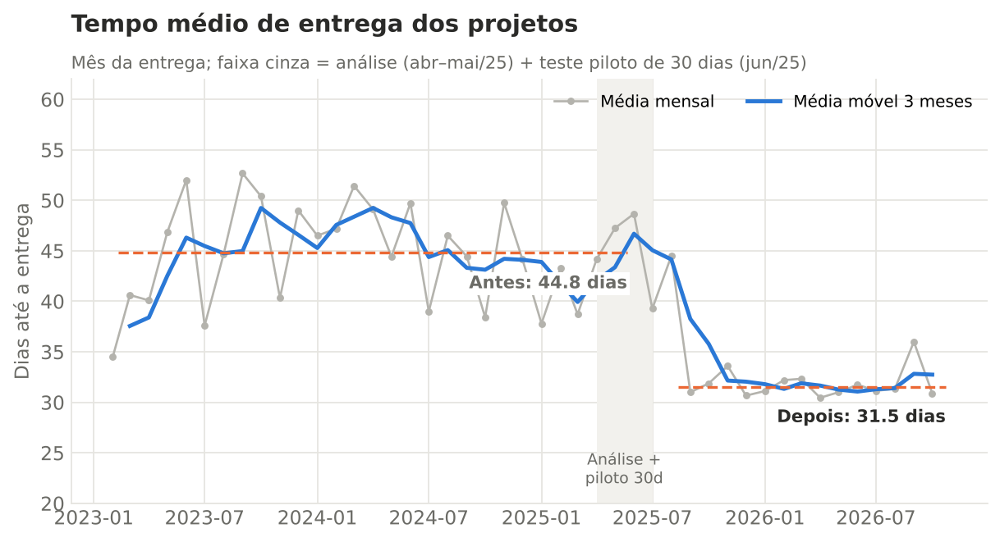
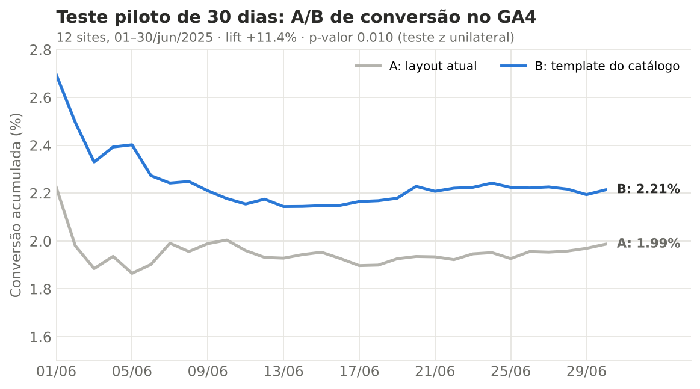
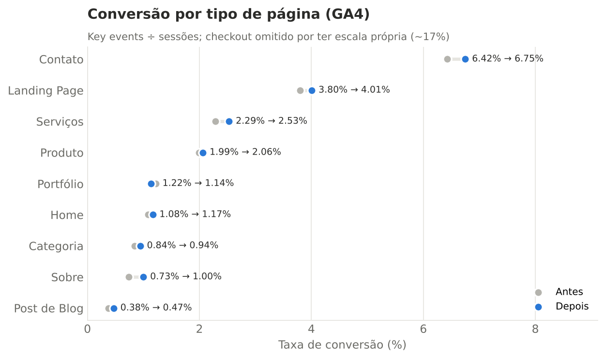

# 🧩 Seleção de Templates WordPress com Dados: −30% no prazo de entrega


> Identifiquei um gargalo no prazo de entrega de sites causado pela **falta de critérios na escolha de layouts**.
> Consolidei o histórico de projetos com SQL, integrei os dados do Google Analytics (nicho, tipo de página e conversão)
> e ranqueei os templates. Antes de mudar o processo, validei a proposta com um **teste piloto de 30 dias**, cujo resultado
> apresentei à gestão em um **dashboard em Excel**. Com a aprovação, padronizei os **10 templates de maior desempenho**,
> com banco centralizado, dashboards no Power BI e um fluxo documentado para a equipe.

<p align="center"></p>

## 🎯 Resultados

| Indicador | Antes | Depois | Variação |
|---|:-:|:-:|:-:|
| **Tempo médio de entrega** | 44,8 dias | 31,5 dias | **−30%** |
| **Taxa de conversão das páginas (GA4)** | 2,0% | 2,2% | **+10%** |
| Entregas dentro do prazo | 26% | 69% | +44 p.p. |
| Rodadas de retrabalho por projeto | 1,50 | 0,61 | −59% |

<sub>Antes: 195 projetos (jan/23–mar/25). Depois: 137 projetos (jul/25–set/26), após o teste piloto de 30 dias em jun/25. Redução de prazo com p < 0,001 (Mann-Whitney).
Ganho de conversão com P(lift > 0) = 97%, IC 95% de −0,4% a +22,7% (bootstrap por projeto), portanto ainda em monitoramento.</sub>

---

## 📌 Problema

Uma agência que desenvolve sites em **WordPress** para 10 nichos (saúde, advocacia, restaurantes, imobiliárias, moda…)
e 6 tipos de site (institucional, landing page, loja WooCommerce, blog, portfólio, catálogo) tinha prazos longos e imprevisíveis.
Cada designer escolhia livremente entre 36 templates. Isso gerava:

- dias perdidos só para **escolher o layout** (a etapa mais variável do ciclo);
- **várias rodadas de aprovação** com o cliente;
- desenvolvimento mais lento com temas pesados (WPBakery/Divi).

## 🔍 Diagnóstico do gargalo

<p align="center"></p>

As etapas *Escolha de layout* e *Design e aprovação* somavam **15,3 dias (34% do ciclo)** sem gerar nada de código.
Depois da padronização, essas duas etapas respondem por **58% da redução total** do prazo.

## 🗓️ Linha do tempo do projeto

| Fase | Período | O que foi feito |
|---|---|---|
| 1. Diagnóstico | abr/2025 | Consolidação do histórico (SQL + GA4) e identificação do gargalo |
| 2. Ranking | mai/2025 | Score de desempenho e seleção dos 10 melhores templates |
| 3. **Teste piloto** | **01 a 30/jun/2025** | Validação em 30 dias, com resultado apresentado em **dashboard Excel** |
| 4. Rollout | jul/2025 → | Catálogo padrão para todos os projetos + Power BI + fluxo documentado |

## 🧪 Teste piloto de 30 dias (junho/2025)

Antes de mudar o processo da equipe inteira, a proposta foi validada em um teste controlado de 30 dias, com duas frentes:

| Frente | Desenho | Métrica |
|---|---|---|
| **Teste A/B de conversão** | 12 sites já publicados; as páginas principais foram reconstruídas com o template do catálogo indicado para o nicho (B) e o tráfego foi dividido 50/50 com o layout atual (A) | Conversão (key events do GA4) |
| **Projetos novos** | 13 projetos iniciados no mês, alternados entre **Controle** (escolha livre) e **Teste** (catálogo top 10 + fluxo) | Dias por etapa, prazo total, retrabalho |

| Resultado do piloto | A / Controle | B / Teste | Variação |
|---|:-:|:-:|:-:|
| Taxa de conversão (A/B, ~86 mil sessões) | 1,99% | 2,21% | **+11,4%** (p = 0,010) |
| Prazo médio de entrega | 44,6 dias | 30,2 dias | **−32%** |
| Dias na escolha de layout | 9,4 | 1,8 | −81% |
| Rodadas de retrabalho | 0,86 | 0,17 | −81% |

O resultado foi apresentado à gestão no **dashboard em Excel** [`excel/dashboard_teste_piloto_30_dias.xlsx`](excel/dashboard_teste_piloto_30_dias.xlsx).
Todos os indicadores são fórmulas sobre os dados brutos, incluindo o teste z de significância. Com os critérios atendidos, a padronização foi aprovada para todos os projetos a partir de julho/2025.

<p align="center"></p>

> O piloto é pequeno em número de projetos (13), então o efeito no prazo foi tratado como indicativo e **confirmado depois do rollout**
> (44,8 → 31,5 dias em 137 projetos). Já o A/B teve amostra suficiente para significância estatística.

## 🛠️ Solução

```
Banco de projetos (SQL) ─┐                                                    Teste piloto 30 dias
                         ├─► Banco centralizado ─► Views SQL ─► Ranking (Python) ─► (dashboard Excel) ─► Rollout
Google Analytics 4 ──────┘     (modelo estrela)                  top 10 templates    A/B + Teste×Controle   Power BI + fluxo
```

**1. Banco centralizado:** modelo estrela com 5 dimensões e 4 fatos (`fato_projetos`, `fato_etapas`, `fato_ga4_paginas`, `fato_teste_ab_ga4`), com chaves estrangeiras e views analíticas.

**2. Integração com o GA4:** sessões, engajamento e key events por página, classificados por **tipo de página** e ligados ao projeto, ao **nicho** e ao **tipo de site**.

**3. Ranking de desempenho:** calculado **apenas com o período Antes**, para evitar vazamento de dados:

| Critério | Peso | Como é medido |
|---|:-:|---|
| Lift de conversão | 40% | conversões reais ÷ esperadas pelo benchmark de nicho × tipo de página |
| Tempo de entrega relativo | 30% | dias ÷ média do tipo de site |
| Rodadas de retrabalho | 15% | média por projeto |
| Entrega no prazo | 15% | % dentro do prazo planejado |

Regras: mínimo de 5 projetos por template e pelo menos 3 templates de cada família (sites gerais e WooCommerce).

<p align="center">


</p>

**4. Classificação por nicho × tipo de site:** uma matriz indica o template padrão para cada combinação.

<p align="center"></p>

**5. Teste piloto + dashboard Excel:** validação de 30 dias antes do rollout (seção acima).

**6. Dashboards no Power BI + fluxo documentado (acompanhamento contínuo):** veja [`powerbi/`](powerbi/README.md) (modelo, DAX, Power Query, tema e layout) e [`docs/fluxo_selecao_templates.md`](docs/fluxo_selecao_templates.md) (procedimento da equipe em fluxograma).

## 📈 Resultado no tempo

<p align="center"></p>
<p align="center"></p>
<p align="center">


</p>

## 🧰 Stack

| Etapa | Ferramentas |
|---|---|
| Banco e consultas | SQL (SQLite; compatível com PostgreSQL/MySQL): CTEs, window functions, views, chaves estrangeiras |
| Dados web | Google Analytics 4 (Data API, script em `src/extrair_ga4.py`) |
| Análise | Python: pandas, NumPy, SciPy (Mann-Whitney, bootstrap) |
| Teste piloto | Excel (dashboard com fórmulas, gráficos e teste z de duas proporções) + teste A/B no WordPress medido no GA4 |
| Visualização | Power BI (DAX, Power Query M, tema JSON) e Matplotlib |
| Documentação | Markdown + Mermaid |

## 📁 Estrutura

```
selecao-templates-wordpress/
├── data/
│   ├── raw/                     # 9 tabelas em CSV (dimensões + fatos + teste A/B)
│   └── agencia_templates.db     # banco SQLite centralizado
├── sql/
│   ├── 01_schema.sql            # modelo estrela com PK/FK
│   ├── 02_views.sql             # camada analítica
│   └── 03_consultas_analiticas.sql
├── src/
│   ├── gerar_dados.py           # simulação do histórico
│   ├── banco.py                 # cria o banco, carrega dados e roda consultas
│   ├── ranking.py               # score de desempenho + seleção do top 10
│   ├── analise.py               # gargalo, antes × depois, testes, matriz
│   ├── graficos.py · dashboard_preview.py
│   ├── dashboard_excel.py       # gera o dashboard Excel do teste piloto
│   ├── extrair_ga4.py           # extração real via GA4 Data API
│   └── pipeline.py              # executa tudo
├── excel/
│   ├── dashboard_teste_piloto_30_dias.xlsx   # dashboard apresentado à gestão
│   └── preview_dashboard_excel.png
├── notebooks/analise_selecao_templates.ipynb
├── powerbi/                     # DAX, Power Query, tema, layout e prévias
├── reports/                     # rankings, catálogo, matriz, gráficos, resultados SQL
└── docs/                        # fluxo da equipe e dicionário de dados
```

## ▶️ Como executar

```bash
git clone https://github.com/Proclise/selecao-templates-wordpress.git
cd selecao-templates-wordpress
python -m venv .venv && source .venv/bin/activate      # Windows: .venv\Scripts\activate
pip install -r requirements.txt

python src/pipeline.py                                 # dados → banco → SQL → ranking → gráficos → Excel
jupyter notebook notebooks/analise_selecao_templates.ipynb
sqlite3 data/agencia_templates.db < sql/03_consultas_analiticas.sql
```

## 🚀 Próximos passos
- [ ] Testes A/B entre templates do catálogo para confirmar o ganho de conversão
- [ ] Incluir Core Web Vitals (LCP, CLS, INP) no score
- [ ] Revisão trimestral automática do ranking com alerta no Power BI

## ⚠️ Sobre os dados
Os dados deste repositório são **simulados** e reproduzem a estrutura e a dinâmica do case descrito acima,
preservando a confidencialidade de clientes e projetos. Nomes de clientes, templates e domínios são fictícios.

---
**Proclise** · [LinkedIn](https://www.linkedin.com/in/seu-perfil) · [GitHub](https://github.com/Proclise)
