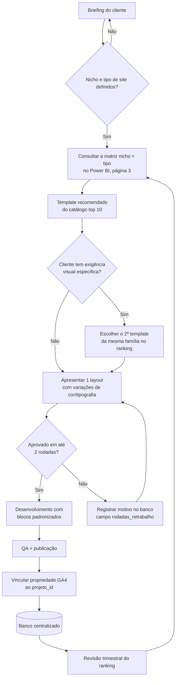

# 🔁 Fluxo de Seleção de Templates (procedimento da equipe)

**Versão:** 1.0, jul/2025 (após aprovação do teste piloto de 30 dias, jun/2025) · **Responsável:** Analista de Dados / Coordenação de Projetos · **Revisão:** trimestral

## Objetivo
Padronizar a escolha do layout de novos sites WordPress com critérios objetivos, para reduzir o tempo de entrega e o retrabalho
e manter a taxa de conversão das páginas acima do benchmark de cada nicho.

## Origem: teste piloto de 30 dias
Este fluxo foi testado de 01 a 30/jun/2025 antes de virar padrão. Os resultados foram apresentados à gestão no
dashboard `excel/dashboard_teste_piloto_30_dias.xlsx`:
- **A/B em 12 sites (GA4):** conversão de 1,99% (layout atual) para 2,21% (template do catálogo), +11,4%, p = 0,010;
- **13 projetos Teste × Controle:** prazo médio de 44,6 para 30,2 dias e retrabalho de 0,86 para 0,17 rodada.

## Fluxo

## Regras

| # | Regra |
|---|---|
| 1 | Todo projeto novo usa um template do **catálogo padrão** (`dim_templates.no_catalogo_padrao = 'Sim'`). |
| 2 | A escolha segue a **matriz nicho × tipo de site** (`reports/matriz_recomendacao_nicho_tipo.csv`). |
| 3 | Fugir da matriz exige justificativa registrada e aprovação da coordenação. |
| 4 | São no máximo **2 rodadas** de aprovação de layout antes de escalar para a coordenação. |
| 5 | Todo site publicado precisa ter o GA4 configurado com os key events padrão: `generate_lead`, `click_whatsapp`, `purchase`. |
| 6 | O `projeto_id` precisa estar no banco **antes** do início do desenvolvimento, com datas de cada etapa. |
| 7 | Mudanças relevantes no catálogo (entrada de novo template) passam por um **A/B de 30 dias** antes de virar padrão, como no piloto. |
| 8 | O ranking é recalculado a cada trimestre (`python src/pipeline.py`). Um template só entra ou sai do catálogo com pelo menos 5 projetos de histórico. |

## Checklist de abertura de projeto

- [ ] Cliente cadastrado (`dim_clientes`) com nicho
- [ ] Tipo de site definido (`dim_tipos_site`)
- [ ] Template escolhido pela matriz e registrado no projeto
- [ ] Prazo planejado preenchido conforme o tipo de site
- [ ] Datas de início e fim de cada etapa registradas (`fato_etapas`)
- [ ] Propriedade GA4 criada e vinculada ao projeto

## Papéis

| Papel | Responsabilidade |
|---|---|
| Atendimento | Briefing completo (nicho, tipo, páginas) |
| Designer | Personalizar o template recomendado (cores, tipografia, imagens) |
| Desenvolvedor | Usar a biblioteca de blocos padronizados do template |
| Analista de dados | Atualizar banco e dashboards; revisar o ranking a cada trimestre |
| Coordenação | Aprovar exceções e acompanhar os KPIs no Power BI |
