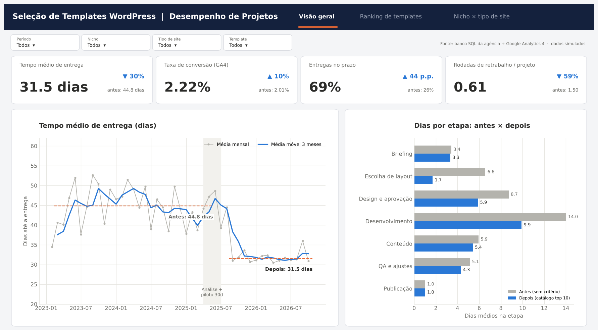
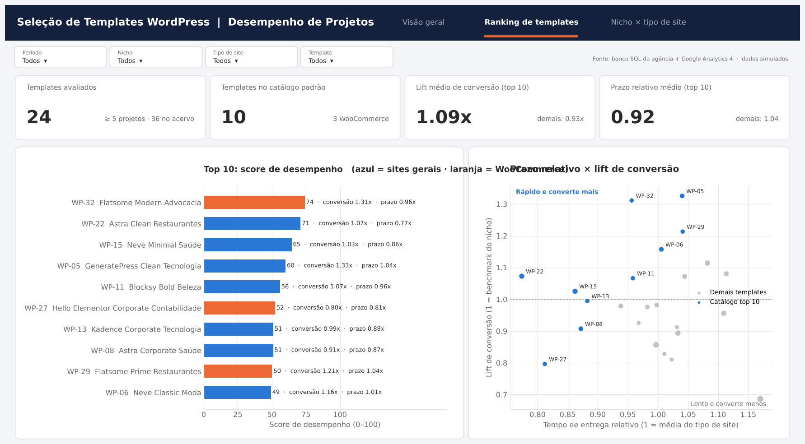
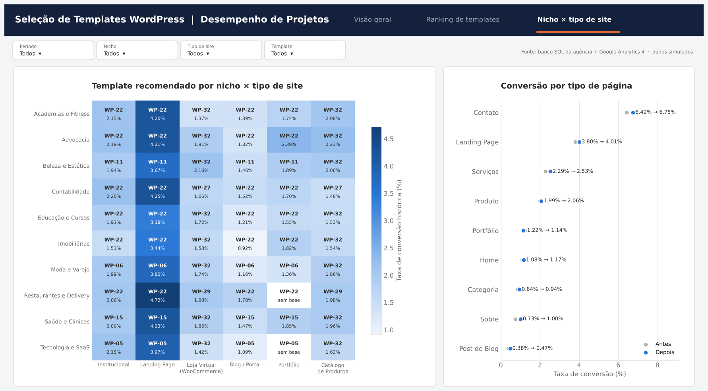

# 📊 Dashboard Power BI

> O **teste piloto de 30 dias** (jun/2025) foi apresentado em Excel: veja [`../excel/`](../excel/).
> O Power BI é o painel de **acompanhamento contínuo** criado após a aprovação do rollout.

O arquivo `.pbix` é montado no Power BI Desktop (Windows) a partir dos arquivos desta pasta, em cerca de 1 hora.
As imagens em `previews/` mostram o layout final de cada página.

| Página 1: Visão geral | Página 2: Ranking | Página 3: Nicho × tipo |
|---|---|---|
|  |  |  |

## 1. Importar os dados

1. **Obter dados**: use o ODBC (SQLite) ou os CSVs de `data/raw/`. Os scripts estão em [`power_query.m`](power_query.m).
2. Importe também `reports/ranking_templates.csv` e `reports/matriz_recomendacao_nicho_tipo.csv`.
3. Crie o parâmetro `PastaProjeto` com o caminho da pasta do projeto.

## 2. Modelo de dados (esquema estrela)

```
                 dim_calendario[data]
                         │ 1
                         ▼ *
dim_clientes ──1:*── fato_projetos ──*:1── dim_templates ──1:1── ranking_templates
dim_nichos   ──1:*──┘    │  │  └──*:1── dim_tipos_site
                         │1 │1
                         ▼* ▼*
              fato_etapas   fato_ga4_paginas
```

| Relação | Cardinalidade | Direção do filtro |
|---|---|---|
| `dim_calendario[data]` → `fato_projetos[data_entrega]` | 1:* | Única |
| `dim_templates[template_id]` → `fato_projetos[template_id]` | 1:* | Única |
| `dim_clientes[cliente_id]` → `fato_projetos[cliente_id]` | 1:* | Única |
| `dim_nichos[nicho]` → `fato_projetos[nicho]` | 1:* | Única |
| `dim_tipos_site[tipo_site]` → `fato_projetos[tipo_site]` | 1:* | Única |
| `fato_projetos[projeto_id]` → `fato_etapas[projeto_id]` | 1:* | Única |
| `fato_projetos[projeto_id]` → `fato_ga4_paginas[projeto_id]` | 1:* | Única |
| `dim_templates[template_id]` → `ranking_templates[template_id]` | 1:1 | Ambas |

> Marque `dim_calendario` como **tabela de datas**. Classifique `fato_etapas[etapa]` por `ordem_etapa`.

## 3. Medidas

Cole as medidas de [`medidas.dax`](medidas.dax) em uma tabela `_Medidas`.

## 4. Tema

**Exibir > Temas > Procurar temas** e selecione [`tema_relatorio.json`](tema_relatorio.json).
A paleta é acessível para daltonismo: azul para "depois" ou ganho, laranja para alerta ou WooCommerce, cinza para "antes".

## 5. Páginas e visuais

**Segmentações em todas as páginas (sincronizadas):** Período · Nicho · Tipo de site · Template

### Página 1: Visão geral
| Visual | Campos |
|---|---|
| 4 cartões (KPI) | `Dias Médios de Entrega`, `Taxa de Conversão`, `% Entregas no Prazo`, `Retrabalho Médio`, cada um com a variação vs. "Antes" |
| Gráfico de linhas | Eixo: `dim_calendario[ano_mes]` · Valores: `Dias Médios de Entrega`, `Dias Médios (Média Móvel 3M)` |
| Barras agrupadas | Eixo: `fato_etapas[etapa]` · Legenda: `periodo` · Valor: média de `dias` |

### Página 2: Ranking de templates
| Visual | Campos |
|---|---|
| Cartões | nº de templates avaliados, nº no catálogo, lift médio (top 10 vs. demais) |
| Barras horizontais | Eixo: `nome_template` · Valor: `Score Template` · Filtro: top 10 por score · Cor: `familia` |
| Dispersão | X: `tempo_relativo` · Y: `lift_conversao` · Tamanho: `projetos` · Legenda: `É Top 10` |
| Tabela | template, tema, builder, score, lift, prazo relativo, % no prazo |

### Página 3: Nicho × tipo de site
| Visual | Campos |
|---|---|
| Matriz (com formatação condicional) | Linhas: `nicho` · Colunas: `tipo_site` · Valores: `Taxa de Conversão` + template recomendado (`matriz_recomendacao`) |
| Halteres / barras agrupadas | Eixo: `tipo_pagina` · Legenda: `periodo` · Valor: `Taxa de Conversão` |

## 6. Atualização

- Agende a atualização no Power BI Service (gateway pessoal para o SQLite/CSV local).
- Em produção, troque a fonte SQLite pelo banco da agência (PostgreSQL/MySQL). As views de `sql/02_views.sql` funcionam com poucos ajustes.
- Os dados do GA4 podem chegar pela **exportação nativa para o BigQuery** ou pelo script `src/extrair_ga4.py`.
